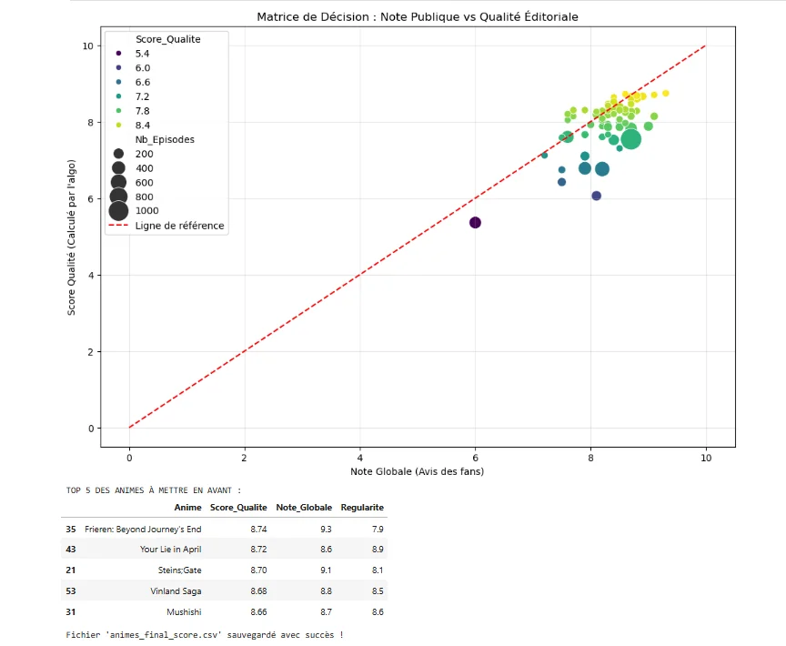

<p align="center"></p>

Une plateforme de streaming veut savoir quelles séries mettre en avant. Le problème : une série très bien notée peut avoir des épisodes très inégaux. J'ai donc construit **un score qui compte aussi la régularité**.

**Étude de cas :** [portfolio-ay-kh.netlify.app/project-anime-scoring](https://portfolio-ay-kh.netlify.app/project-anime-scoring.html)

## Le calcul

```python
# écart entre le meilleur et le pire épisode
df['Ecart'] = df['Note_Meilleur_Ep'] - df['Note_Pire_Ep']

# plus c'est proche de 10, plus la série est régulière
df['Regularite'] = 10 - df['Ecart']

# 60 % note du public, 40 % régularité
df['Score_Qualite'] = 0.6 * df['Note_Globale'] + 0.4 * df['Regularite']
```

## Le top 5

| # | Série | Score | Note publique | Régularité |
|:-:|---|:-:|:-:|:-:|
| 1 | Frieren: Beyond Journey's End | **8,74** | 9,3 | 7,9 |
| 2 | Your Lie in April | **8,72** | 8,6 | 8,9 |
| 3 | Steins;Gate | **8,70** | 9,1 | 8,1 |
| 4 | Vinland Saga | **8,68** | 8,8 | 8,5 |
| 5 | Mushishi | **8,66** | 8,7 | 8,6 |

Your Lie in April passe devant Steins;Gate alors que le public le note moins bien : c'est sa régularité qui fait la différence.

- Le studio le plus régulier en moyenne : **Artland**.
- Plus une série est longue, moins elle est régulière.
- **Frieren** et **Claymore** ressortent comme des valeurs sûres.

<p align="center"></p>

## Les fichiers

| Fichier | Contenu |
|---|---|
| `Untitled1.ipynb` | Le notebook : nettoyage, nouvelles colonnes, score, graphiques |
| `clean_data_set.csv` | Les 72 séries après nettoyage |
| `animes_final_score.csv` | Le résultat avec le score de chaque série |

## Outils

Python, Pandas, NumPy, Seaborn, Matplotlib, Jupyter.
